# The Five Control Surfaces of Modern AI Engineering

*By Hariharan*

A clever prompt can rescue one conversation. It cannot carry a product. Once an AI feature has to answer the same question correctly for the thousandth user, on a bad network day, with a half-broken downstream API, the thing that keeps it honest is not phrasing. It is engineering.

I have started thinking about that engineering as a set of **control surfaces** — the specific places where I, as the builder, actually get to steer what the model does. Each surface answers a different question, each one fails in its own way, and skipping any of them quietly caps how reliable the whole system can ever be.

There are five. They stack. You climb them in order, and you do not get to pretend the lower ones are solved just because you reached the top.

> **The short version:** prompt → context → harness → loop → graph. Instruction, information, capability, progress, coordination. Each layer answers a question the one below it cannot.

## The one-screen map

Here is the whole idea before I unpack it. Read it bottom to top — that is the order you build in, and the order each layer depends on the one beneath it.

```mermaid
flowchart BT
    P["① PROMPT — control the instruction<br/><i>what do I want the model to do?</i>"]
    C["② CONTEXT — control the information<br/><i>what does the model need to know right now?</i>"]
    H["③ HARNESS — control the capability<br/><i>what is the model allowed to actually do?</i>"]
    L["④ LOOP — control the progress<br/><i>how does it keep going until the job is done?</i>"]
    G["⑤ GRAPH — control the coordination<br/><i>how do many of these work together?</i>"]

    P --> C --> H --> L --> G

    P -. "a great prompt on a shaky base is still a shaky system" .-> G

    classDef l1 fill:#eef2ff,stroke:#6d28d9,color:#1e1b4b;
    classDef l2 fill:#e0f2fe,stroke:#0ea5e9,color:#0c4a6e;
    classDef l3 fill:#ecfdf5,stroke:#059669,color:#064e3b;
    classDef l4 fill:#fff7ed,stroke:#ea580c,color:#7c2d12;
    classDef l5 fill:#fdf2f8,stroke:#db2777,color:#831843;
    class P l1; class C l2; class H l3; class L l4; class G l5;
```

The dashed line is the point most teams learn the hard way: a brilliant instruction sitting on a weak foundation is still a weak system. Reliability is set by your *lowest* solved layer, not your best one.

## A single task, climbing all five layers

Abstractions are easy to nod along to and hard to use. So I will carry one concrete task through every surface:

> *"Answer a customer's billing question using their account, and issue a refund if policy allows."*

Watch how the same task needs something different from each layer.

## 1. Prompt — control the instruction

**The question it answers:** *What, exactly, do I want?*

This is where most people start and, unfortunately, where many stop. The prompt is how you pin down the task, the tone, the output shape, and the boundaries of what counts as a good answer. Done well, it removes ambiguity so the model is solving *your* problem rather than a nearby one it invented.

For the refund task, the prompt fixes the role ("you are a billing assistant"), the format ("reply in two short paragraphs, then a decision line"), and the hard rules ("never promise a refund you are not certain about").

**What I watch to know it is working**

- Answers match the task instead of drifting to an adjacent one
- The output format is consistent enough to parse or display without cleanup
- Fewer confident-but-wrong statements
- I can iterate on behavior by editing words, not rewriting code

**How it breaks**

- The model solves a slightly different problem than the one I meant
- Instructions quietly contradict each other and the model picks one
- Output shape wobbles from call to call

**The ceiling:** a perfect prompt still only governs a single turn. It knows nothing it was not told. That gap is the next layer's job.

## 2. Context — control the information

**The question it answers:** *What does the model need to know, right now, for this specific request?*

A model is only as grounded as what you place in front of it. Context engineering is the discipline of assembling the right material at the right moment — the relevant policy section, the customer's recent invoices, a couple of worked examples, the memory of what happened earlier in the conversation — and leaving out the rest.

The "leaving out" matters as much as the "putting in." Stuffing everything into the window is not context engineering; it is hoarding. Good context is *selected*.

For the refund task, this layer retrieves the customer's last three charges and the exact clause of the refund policy that applies — and nothing else that would dilute attention.

**What I watch**

- Retrieved material is actually relevant to the question asked
- Answers are grounded in the supplied facts, not invented
- The context window carries signal, not filler
- Nothing important silently falls out of memory mid-task

**How it breaks**

- The right document is missing, so the model guesses
- Noisy or off-topic context drowns the useful part
- The window is so overloaded that key facts get ignored

**The ceiling:** now the model knows the right things and can say the right words — but it still cannot *do* anything. It cannot read the live account or move money. That is capability, and it needs a harness.

## 3. Harness — control the capability

**The question it answers:** *What is the model actually allowed to do, and under what safeguards?*

The harness is everything wrapped around the model that turns language into action: tools and APIs it can call, the permissions that fence those calls in, the validation that checks a result before trusting it, and the observability that lets me see what happened. This is where "a chatbot that talks about refunds" becomes "a system that can issue one."

It is also where safety stops being a vibe and becomes a mechanism. A refund tool should refuse amounts over a threshold, require the account to be verified, and log every call. The model proposes; the harness decides what is permitted.

For the refund task, the harness exposes a `lookup_account` tool and an `issue_refund` tool — the second gated behind a policy check and an audit log.

**What I watch**

- Tool calls succeed and return usable results
- Permission rules are respected, every time, not most of the time
- Results are validated before the system acts on them
- I have traces to answer "what did it do and why"

**How it breaks**

- A tool runs when it should have been blocked
- The model acts on an unverified or malformed result
- Side effects fire that no one intended, with no trail to explain them

**The ceiling:** the model can now act once. But real tasks are rarely one clean step. It needs to try, check, and continue — which means a loop.

## 4. Loop — control the progress

**The question it answers:** *How does the system keep making real progress until the job is genuinely done — and how does it know when to stop?*

A single call is a guess. A loop is a worker. Loop engineering is designing the cycle — plan, act, observe, evaluate, decide whether to continue — plus the two things people forget: a reliable **stopping condition** and an **independent check** on progress.

The hard part is not the looping. It is stopping well. A loop that grades its own homework will happily declare victory on a wrong answer, and a loop with no brake will burn tokens forever. Good loop design borrows a result it can trust — a tool result, a validator, a second model with a narrow job — to decide whether it actually advanced.

For the refund task: look up the account, realize the charge is ambiguous, fetch one more invoice, re-evaluate against policy, then either issue the refund or escalate — and stop the moment the decision is made.

**What I watch**

- Tasks that need several steps actually finish
- Each iteration moves forward instead of circling
- The system halts on a clear, trustworthy condition
- Retries are targeted, not blind repetition

**How it breaks**

- It stops too early and calls a half-answer "done"
- It grades its own output with no outside check and fools itself
- State leaks between iterations and the loop loses the thread

**The ceiling:** one capable, self-correcting worker is powerful — but some problems are bigger than one worker. They need division of labor.

## 5. Graph — control the coordination

**The question it answers:** *How do several agents, tools, and steps work together without stepping on each other?*

This is the newest surface and the least settled — the term itself is still crystallizing in 2026. Graph engineering is how you connect multiple specialized workers and the flow between them: a router that sends work to the right place, specialists that each own a slice, and the joins where their outputs come back together. When a task is too large or too varied for one loop, you decompose it into a graph of cooperating pieces.

The value is specialization and parallelism; the danger is that coordination itself becomes the bug. A graph fails not because any single agent is weak, but because the handoffs between them are.

For the refund task at scale: a router classifies incoming messages, a billing specialist handles the refund path, a separate fraud-check runs in parallel, and a final step reconciles their verdicts before anything is promised to the customer.

**What I watch**

- Work reaches the right specialist the first time
- Independent branches run in parallel and rejoin cleanly
- Each node succeeds on its own slice
- Fewer failures that live purely in the handoffs

**How it breaks**

- Brittle orchestration that shatters when one node changes
- A router that sends work down the wrong path
- Handoffs that drop or garble state between agents

**The ceiling:** there isn't a clean one yet — this is the frontier. But the lesson rhymes with every layer below: coordination is only as good as the loops, harnesses, context, and prompts it is built on.

## Why the order is not negotiable

The five surfaces are a ladder, not a menu. Each one answers a question the layer beneath it structurally *cannot*:

| Layer | Controls | The question only it can answer |
|-------|----------|---------------------------------|
| Prompt | the instruction | What do I want? |
| Context | the information | What should it know now? |
| Harness | the capability | What may it actually do? |
| Loop | the progress | How does it finish, and stop? |
| Graph | the coordination | How do many pieces cooperate? |

You can have a beautiful prompt and still ship an unreliable product, because the prompt was never the part that was going to fail at scale. The real question stopped being *"how do I get a better answer out of the model?"* a while ago. The question now is *"how do I build a system that produces the right outcome, again and again, when conditions are bad?"*

That reframing — from a single response to a reliable system — is the whole shift. Prompt engineering was the on-ramp. These five surfaces are the road.

## A checklist I actually use

If you are building agents, RAG systems, or anything meant to run in production, this is the order I pressure-test:

1. **Prompt** — Is the task unambiguous and the output shape fixed?
2. **Context** — Is the model grounded in selected, relevant facts — and nothing else?
3. **Harness** — Are tools, permissions, validation, and tracing in place before it can act?
4. **Loop** — Does it make checked progress and stop on a condition I trust?
5. **Graph** — When one worker isn't enough, do the handoffs hold?

Fix them bottom-up. Your system is exactly as reliable as the lowest rung you have actually solved.

---

*Written by Hariharan. This is my own framing of how reliable AI systems come together, drawn from building and reasoning about production AI workflows. Reuse the checklist freely.*
