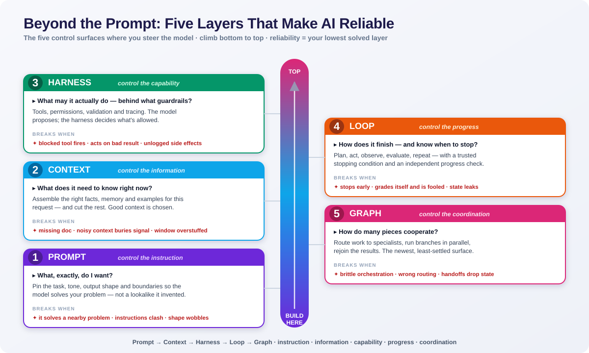
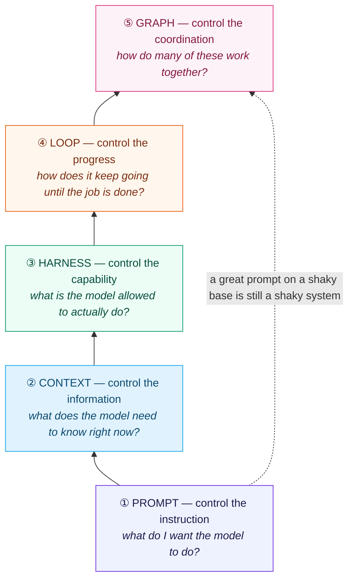

# Beyond the Prompt: Five Layers That Make AI Reliable

*By Hariharan*

A clever prompt wins one conversation. It never carries a product.

Ship an AI feature and reality shows up fast: the thousandth user, the bad network day, the downstream API that's half-broken. Phrasing won't save you there. Engineering will.

So stop thinking in prompts. Think in **control surfaces** — the exact places where you get to steer the model. Five of them. Each answers a question the others can't. Each fails in its own way. Skip one and you've already capped how reliable your system can be — you just don't know it yet.

They stack. You climb them in order. And reaching the top doesn't let you pretend the bottom is solved.

> **The short version:** prompt → context → harness → loop → graph. Instruction, information, capability, progress, coordination. Every layer answers a question the one below it can't.

## The one-screen map

The poster above is the whole idea at a glance — five cards, each with its question and its failure mode. If you prefer the dependency view, here it is as a ladder. Read it bottom to top: that's the order you build in, and the order each layer leans on the one beneath it.

The dashed line is the lesson teams learn the hard way. A brilliant instruction on a weak foundation is still a weak system. Your reliability is set by your *lowest* solved layer — never your best one.

## One task, all five layers

Frameworks are easy to nod at and hard to use. So let's drag one real task through every surface:

> *"Answer a customer's billing question using their account, and issue a refund if policy allows."*

Same task, five layers. Watch what each one demands.

## 1. Prompt — control the instruction

**The question it answers:** *What, exactly, do I want?*

Most people start here. Too many stop here. The prompt pins down the task, the tone, the output shape, and the line between a good answer and a bad one. Nail it and the model solves *your* problem — not the lookalike it invented.

For the refund task, the prompt locks the role ("you are a billing assistant"), the format ("two short paragraphs, then a decision line"), and the hard rule ("never promise a refund you aren't certain about").

**What tells you it's working**

- Answers hit the task instead of drifting to a neighbor
- Output format is consistent enough to parse or display with zero cleanup
- Fewer confident-but-wrong statements
- You tune behavior by editing words, not rewriting code

**How it breaks**

- The model solves a slightly different problem than you meant
- Instructions quietly contradict each other and the model picks a side
- Output shape wobbles call to call

**The ceiling:** a perfect prompt governs exactly one turn. It knows nothing you didn't tell it. Closing that gap is the next layer's job.

## 2. Context — control the information

**The question it answers:** *What does the model need to know, right now, for this request?*

A model is only as grounded as what you put in front of it. Context engineering is the craft of assembling the right material at the right moment — the relevant policy clause, the customer's recent invoices, a couple of examples, the memory of what already happened — and cutting everything else.

The cutting matters as much as the adding. Dumping everything into the window isn't context engineering. It's hoarding. Good context is *chosen*.

For the refund task, this layer pulls the customer's last three charges and the one policy clause that applies — and nothing that would dilute the model's attention.

**What tells you it's working**

- Retrieved material actually answers the question asked
- Answers stand on supplied facts, not invention
- The window carries signal, not filler
- Nothing important drops out of memory mid-task

**How it breaks**

- The right document is missing, so the model guesses
- Noisy context buries the useful part
- The window is so stuffed that key facts get ignored

**The ceiling:** now the model knows the right things and says the right words — but it still can't *do* anything. It can't read the live account or move money. That's capability. It needs a harness.

## 3. Harness — control the capability

**The question it answers:** *What is the model actually allowed to do, and behind what guardrails?*

The harness is everything wrapped around the model that turns language into action: the tools and APIs it can call, the permissions that fence those calls in, the validation that checks a result before you trust it, the observability that shows you what happened. This is where "a bot that talks about refunds" becomes "a system that issues one."

It's also where safety stops being a vibe and becomes a mechanism. The refund tool refuses amounts over a threshold, demands a verified account, and logs every call. The model proposes. The harness decides what's allowed.

For the refund task, the harness exposes a `lookup_account` tool and an `issue_refund` tool — the second gated behind a policy check and an audit log.

**What tells you it's working**

- Tool calls succeed and return something usable
- Permission rules hold every time, not most of the time
- Results get validated before the system acts on them
- You have traces that answer "what did it do, and why"

**How it breaks**

- A tool fires when it should have been blocked
- The model acts on an unverified or malformed result
- Side effects nobody intended, with no trail to explain them

**The ceiling:** the model can act once. Real tasks are rarely one clean step. It has to try, check, and continue — which means a loop.

## 4. Loop — control the progress

**The question it answers:** *How does the system keep making real progress until the job is actually done — and how does it know to stop?*

A single call is a guess. A loop is a worker. Loop engineering designs the cycle — plan, act, observe, evaluate, decide whether to continue — plus the two things everyone forgets: a reliable **stopping condition** and an **independent check** on progress.

The looping isn't the hard part. Stopping well is. A loop that grades its own homework will cheerfully declare victory on a wrong answer. A loop with no brake burns tokens forever. So good loops lean on a result they can trust — a tool output, a validator, a second model with one narrow job — to judge whether they actually moved forward.

For the refund task: look up the account, spot an ambiguous charge, pull one more invoice, re-check against policy, then either issue the refund or escalate — and stop the instant the decision is made.

**What tells you it's working**

- Multi-step tasks actually finish
- Every iteration moves forward instead of circling
- The system halts on a clear, trustworthy condition
- Retries are targeted, not blind repetition

**How it breaks**

- It stops early and calls a half-answer "done"
- It grades itself with no outside check and fools itself
- State leaks between iterations and the loop loses the thread

**The ceiling:** one self-correcting worker is powerful. Some problems are still too big for one worker. They need division of labor.

## 5. Graph — control the coordination

**The question it answers:** *How do several agents, tools, and steps work together without tripping over each other?*

This is the newest surface and the least settled — the name itself is still forming in 2026. Graph engineering is how you wire multiple specialists together and route the flow between them: a router that sends work to the right place, specialists that each own a slice, and the joins where their outputs come back together. When a task is too big or too varied for one loop, you break it into a graph of cooperating pieces.

The upside is specialization and parallelism. The trap is that coordination itself becomes the bug. Graphs rarely fail because one agent is weak. They fail at the handoffs.

For the refund task at scale: a router classifies the incoming message, a billing specialist runs the refund path, a fraud check runs in parallel, and a final step reconciles both verdicts before anything is promised to the customer.

**What tells you it's working**

- Work reaches the right specialist on the first hop
- Parallel branches run independently and rejoin cleanly
- Each node succeeds on its own slice
- Fewer failures that live purely in the handoffs

**How it breaks**

- Brittle orchestration that shatters when one node changes
- A router that sends work down the wrong path
- Handoffs that drop or garble state between agents

**The ceiling:** there isn't a clean one yet — this is the frontier. But the lesson rhymes with every layer below it: coordination is only ever as good as the loops, harnesses, context, and prompts it stands on.

## Why the order isn't negotiable

The five surfaces are a ladder, not a menu. Each one answers a question the layer beneath it structurally *can't*:

| Layer | Controls | The question only it can answer |
|-------|----------|---------------------------------|
| Prompt | the instruction | What do I want? |
| Context | the information | What should it know now? |
| Harness | the capability | What may it actually do? |
| Loop | the progress | How does it finish, and stop? |
| Graph | the coordination | How do many pieces cooperate? |

You can write a beautiful prompt and still ship an unreliable product — because the prompt was never the part going to fail at scale. The real question stopped being *"how do I get a better answer out of the model?"* a long time ago. It's now *"how do I build a system that produces the right outcome, again and again, when conditions are bad?"*

That shift — from a single response to a reliable system — is the whole game. Prompt engineering was the on-ramp. These five surfaces are the road.

## The checklist I actually use

Building agents, RAG systems, or anything headed for production? This is the order I pressure-test, every time:

1. **Prompt** — Is the task unambiguous and the output shape fixed?
2. **Context** — Is the model grounded in chosen, relevant facts — and nothing else?
3. **Harness** — Are tools, permissions, validation, and tracing in place before it can act?
4. **Loop** — Does it make checked progress and stop on a condition you trust?
5. **Graph** — When one worker isn't enough, do the handoffs hold?

Fix them bottom-up. Your system is exactly as reliable as the lowest rung you've actually solved.

---

*Written by Hariharan. My own framing of how reliable AI systems come together, built from working on production AI workflows. Take the checklist and use it.*
